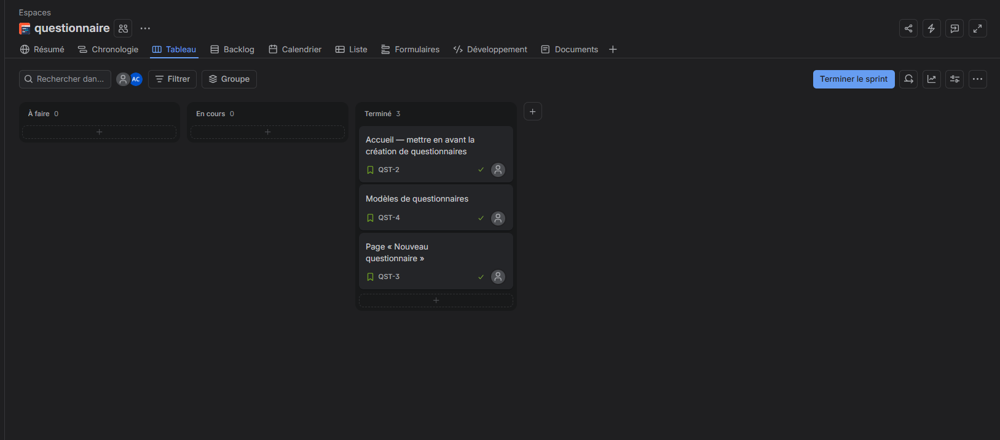

# Livrable TP1

- **Membre A :** Abd errahmen chrif (@AbderrahmenChrif)
- **Membre B :** Non applicable (travail individuel)
- **Fork :** https://github.com/AbderrahmenChrif/devops2-tp1
- **Site Jira :** https://abdelrahmenchrif2004.atlassian.net

## Réalisation des tickets

- **QST-1 :** Livrable du TP1 et capture du tableau Jira.
- **QST-2 :** Réalisée par A — Modification de la page d'accueil pour mettre en avant la création de questionnaires.
- **QST-3 :** Réalisée par A — Création de la page « Nouveau questionnaire » avec les champs Titre et Description et le bouton Enregistrer désactivé.
- **QST-4 (bonus) :** Réalisée par A — Création et intégration de trois modèles de questionnaires sur la page d'accueil.

## Bonus

- **Liaison Jira ↔ GitHub :** Réalisée — Connexion du dépôt GitHub au projet Jira et vérification de l'affichage des branches, commits et Pull Requests dans les tickets.

## Capture du tableau Jira

